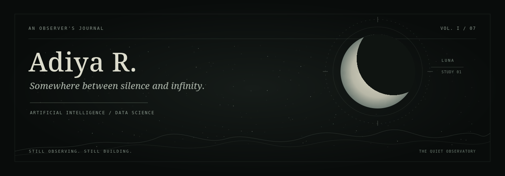

 

*Quietly curious about how things work — and what we might build next.*

 

### Ⅰ. The observer

I'm **Adiya**, an AI & Data Science student exploring the space between ideas and working systems. I like thoughtful software, difficult questions, mountain landscapes, and looking up at the night sky.

I build to learn. And I document what I discover along the way.

 

### Ⅱ. Selected observations

**001 — [NEXUS](https://github.com/Adiya-07/NEXUS)**  
*A local AI assistant for natural-language file operations.*  
Permission-gated actions, an auditable execution layer, and a modular Python architecture. An ongoing exploration.

**002 — FABLE**  
*Can we understand why some content travels further than others?*  
An AI & analytics project exploring video and image virality, mood, and reach. **In development · Repository not yet published.**

**003 — [AstroGuy AI](https://github.com/Adiya-07/PYEXPO-PY003)**  
*Tradition, computation, and curiosity.*  
A bilingual astrology-inspired web application featuring charts, calendars, and machine-learning components.

 

### Ⅲ. Working notes

**Currently exploring** — Python · AI / ML · data science · building useful applications  
**Beyond the screen** — mountains · astronomy · quiet places

 

---

THE QUIET OBSERVATORY &nbsp; · &nbsp; FIELD NOTES / AR—07

 
 

<em>There's always more to discover.</em>

