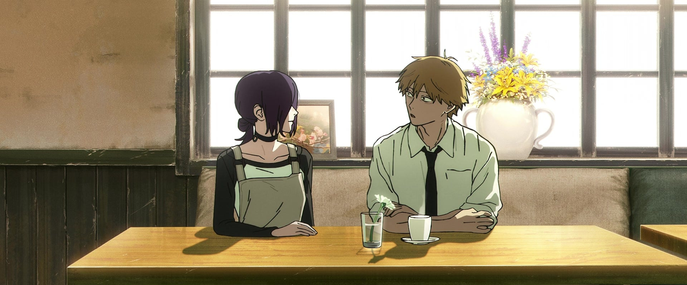
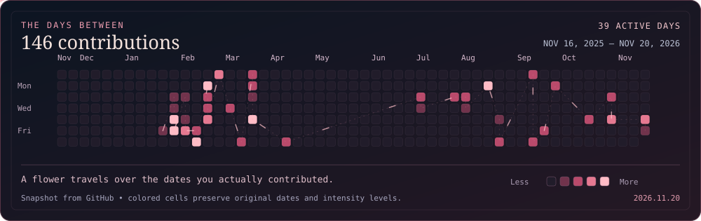
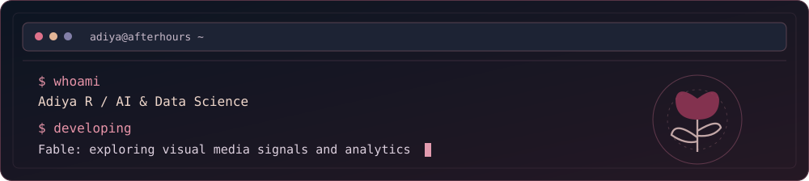
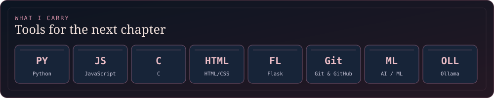
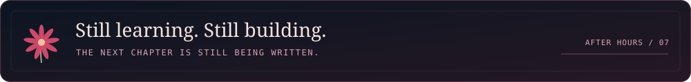

**AI & Data Science student · Building AI-powered and data-driven applications**

[Portfolio](https://github.com/Adiya-07/my_portfolio) &nbsp; / &nbsp; [LinkedIn](https://www.linkedin.com/in/adiya-r-a27b74377/) &nbsp; / &nbsp; [Explore my repositories](https://github.com/Adiya-07?tab=repositories)

## Hey, I'm Adiya

I'm studying **B.Tech in Artificial Intelligence & Data Science** at **KGiSL Institute of Technology**. I enjoy building software that connects AI, data and interactive experiences.

I'm currently exploring **local AI, machine learning, data visualization and software development**. Outside code, I love cinema, mountains, night skies and stories like Chainsaw Man's Reze Arc.

## My contribution trail

Real contribution calendar snapshot captured November 20, 2026. The colors match GitHub's original intensity levels; the flower is decorative. GitHub's live contribution calendar remains below this README.

## Explore my work

| Project | What you'll find |
| --- | --- |
| [**AstroGuy AI**](https://github.com/Adiya-07/PYEXPO-PY003) | Python/Flask web app with interactive charts and an ML chatbot; second prize at PyExpo. |
| [**NEXUS**](https://github.com/Adiya-07/NEXUS) | Local AI file assistant exploring permission-first architecture and audit history. Phase 1 prototype, paused. |
| **Fable** | In development: exploring image/video characteristics and potential audience reach with visual analytics. |
| [**Finger Driver**](https://github.com/Adiya-07/Finger_driver) | Webcam-controlled browser game using computer vision, with keyboard fallback. |
| [**Epic Habit RPG**](https://github.com/Adiya-07/Epic-habit-tracker-) | Gamified habit tracking with character progression, streaks and analytics. |

## What I'm focused on

- **AI & ML:** local models, computer vision and practical machine learning.
- **Data Science:** visual analytics, storytelling and exploring patterns in data.
- **Software development:** building useful projects and improving my problem-solving skills.
- **Creative development:** cinematic interfaces and interactive web experiences.

## My toolkit

**Languages:** Python · JavaScript · C · HTML & CSS

**Tools and technologies:** Git · GitHub · Flask · Ollama · AI / ML (learning and building)

## Let's connect

Interested in collaborating on **AI projects, data-driven applications, creative interfaces and student hackathons**. Find me on [LinkedIn](https://www.linkedin.com/in/adiya-r-a27b74377/) or [GitHub](https://github.com/Adiya-07).

Before the Rain · [Film still](https://fancaps.net/movies/Image.php?imageid=13468812) from Chainsaw Man – The Movie: Reze Arc. © 2025 MAPPA / Chainsaw Man Project · Tatsuki Fujimoto / Shueisha.

