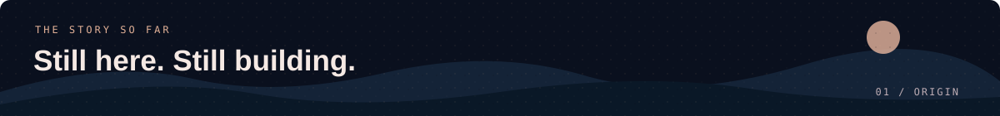
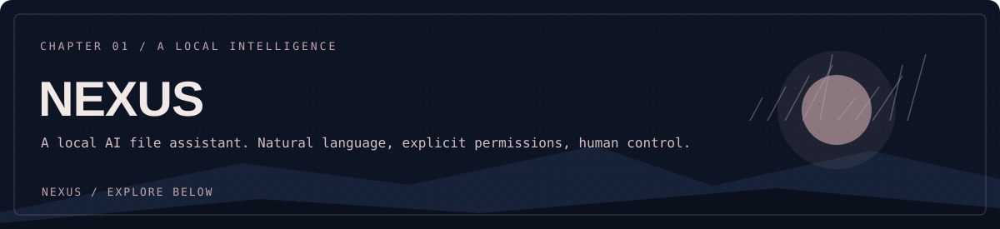
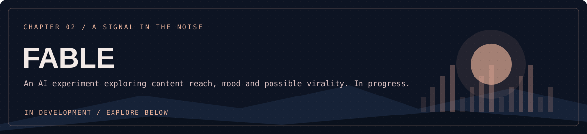
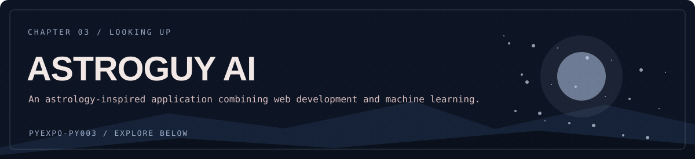
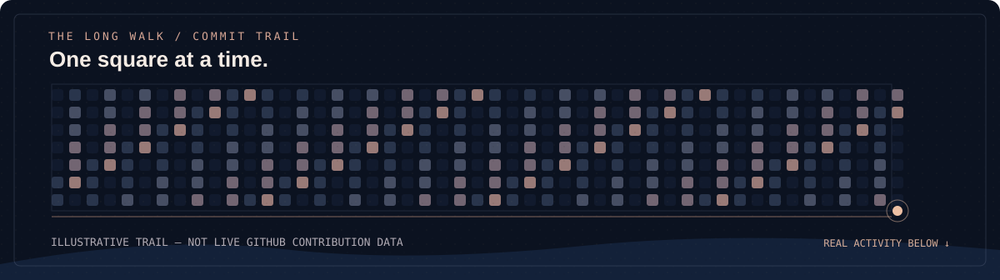
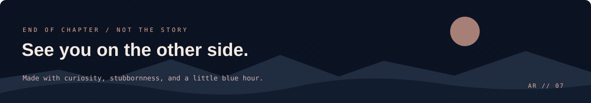

<div align="center">



<br/>

**AI & Data Science · Python · Building the next chapter**

[**Explore my code**](https://github.com/Adiya-07?tab=repositories) &nbsp; · &nbsp; [**NEXUS**](https://github.com/Adiya-07/NEXUS) &nbsp; · &nbsp; [**AstroGuy AI**](https://github.com/Adiya-07/PYEXPO-PY003)

</div>

<br/>



I'm **Adiya**, an AI & Data Science student who likes making software, discovering how things work, and getting lost in mountains, stories, and the night sky.

I'm learning **Python, AI/ML, and problem-solving** by actually building things. Some ideas work. Some don't. Every attempt becomes part of the story.

> *It's not about knowing how it ends. It's about finding out what happens next.*

<br/>

### 02 / The chapters

<a href="https://github.com/Adiya-07/NEXUS"></a>

NEXUS is a local AI assistant for natural-language file operations, with permissions and a human-in-control design. **[Open the repository →](https://github.com/Adiya-07/NEXUS)**



Fable explores how video and image features might relate to reach, mood, and virality. **In development — not publicly published yet.**

<a href="https://github.com/Adiya-07/PYEXPO-PY003"></a>

AstroGuy AI explores charts, calendars, web development, and machine learning. **[Open the repository →](https://github.com/Adiya-07/PYEXPO-PY003)**

<br/>

### 03 / What I carry

```text
LANGUAGES     Python · Java · C (learning and building)
EXPLORING     AI / ML · Data Science · Problem Solving
BEYOND CODE   Mountains · Cinema · Stories · Night Skies
CURRENT MODE  Learning, experimenting, becoming better
```

<br/>

### 04 / The long walk



<sub>This trail is original artwork, **not a record of actual contribution counts**. My genuine GitHub activity is shown in GitHub's contribution calendar below this profile README.</sub>

<br/>



<div align="center">

<sub>BLUE HOUR / THE LAST SAVE  ·  ORIGINAL ARTWORK  ·  AR–07</sub>

</div>
